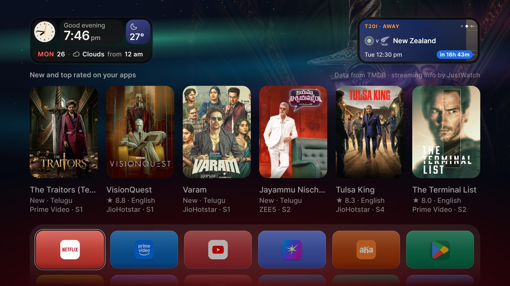

# Afterglow

*A calm home screen for Android TV.*

**Your TV's home screen, minus the noise.** No ads, no "sponsored" rows, no clutter. Just the time, what's
new on the apps you pay for, the next big match, and your apps, laid out on a quiet night sky.

## What you see

**🕐 The clock card** (top left)
A little watch face, a "Good evening", the time, and today's weather in a square that's the colour of the
sky outside. One line underneath reads like a sentence: *"MON 26 · Clouds from 12 am."*

**⚽ The sports card** (top right)
One card with three sides: **Arsenal's next match**, **India's next cricket match** and the **next F1
race**. Select it and press left or right to flip it over. Each side has its own look: a floodlit pitch,
a blue night with the cricket strip, a carbon-black race car finish. It tells you when it starts in your
time, counts down, and says **Live** while it's on.

**🎬 New and top rated on your apps** (middle)
Six shows and movies that came out in the last two weeks and are already streaming on the apps on your TV.
English and Telugu first, Hindi after. The best rated lead; brand-new ones still waiting for ratings say
**New**. No cartoons or anime. Move onto a poster and its artwork softly fills the sky behind it.

**📺 Your apps** (bottom)
Every app, six to a row, each on a card in its own brand colour, all equally bright, so nothing shouts.
Press down for more rows; the page lifts gently to show them.

**✨ The feel**
A slow aurora and a few twinkling stars behind frosted-glass cards. A soft light under the apps (the
afterglow) shines in the colour of whatever you're on. Moving around is calm: a thin ring and a colour change, nothing jumps
or grows.

## Set it up

You need a Mac, an Android TV on the same Wi-Fi, and about ten minutes.

1. **On the TV**: Settings → Device Preferences → About → click *Build* seven times. Then in Developer
   options turn on **USB debugging** (and network debugging, if your TV shows it).
2. **On the Mac**, install the tools once:

       brew install openjdk@17 gradle
       brew install --cask android-platform-tools android-commandlinetools
       sdkmanager "platforms;android-34" "build-tools;34.0.0"

3. **Connect** to the TV (allow the prompt on screen):

       adb connect <your-tv-ip>:5555

4. **Add your free TMDB token** (for the shows and movies): create an account at themoviedb.org, go to
   Settings → API, copy the *API Read Access Token*, and save it in `launcher/tmdb.properties`:

       tmdb.token=eyJ...

   This file never leaves your Mac (git ignores it). Without it, everything works except that shelf.

5. **Build, install and switch to it**:

       ./build.sh
       ./install.sh
       ./activate.sh

## Make it yours

Open `launcher/app/src/main/res/values/config.xml`:

| Setting | What it does |
|---|---|
| `dock_apps`, `grid_apps` | The apps that come first, in your order. Everything else follows A to Z. |
| `hidden_apps` | Apps to keep off the screen (they stay installed). |
| `weather_lat`, `weather_lon`, `weather_place` | Where your weather is from. |
| `columns` | Apps per row (6). |
| `effects` | 2 = full animation, 1 = lighter (good for TVs with little memory), 0 = still. |

Want different teams, languages or streaming apps? They're near the top of `Sports.java` (team ids from
TheSportsDB) and `Shelf.java` (`LANGUAGES`, `SERVICES`). Brand colours are in `DockView.java`. Run
`./build.sh` and `./install.sh` again after any change.

**Changed your mind?** `./restore-launcher.sh` brings back the TV's original home screen.

## Good to know

- **Light on your TV.** Under 1 MB, no extra libraries. On a Sony Bravia with about 1.2 GB of free
  memory it stays smooth (under 1% dropped frames).
- **Light on your network.** Weather every 30 minutes, shows every 4 hours, sports every 3 hours, and only
  while the home screen is showing. Everything is saved, so it appears instantly after a restart.
- **Nothing is removed from your TV.** It's just another app set as the home screen.

## Credits and licence

MIT licensed, see [LICENSE](LICENSE). Fonts (Open Runde), icons (Phosphor) and data (TMDB, TheSportsDB,
Jolpica-F1, Open-Meteo) are listed in [NOTICE.md](NOTICE.md), with their licences in `licenses/`. App names,
logos and posters belong to their owners.
